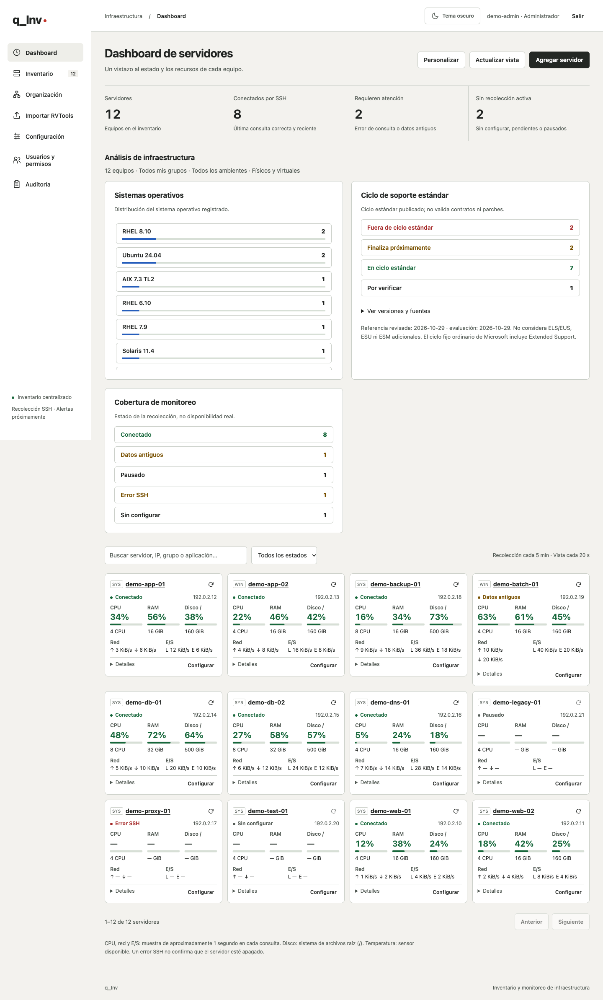
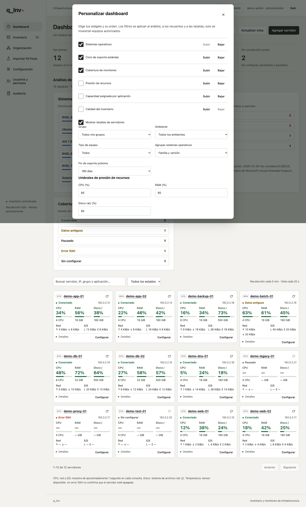
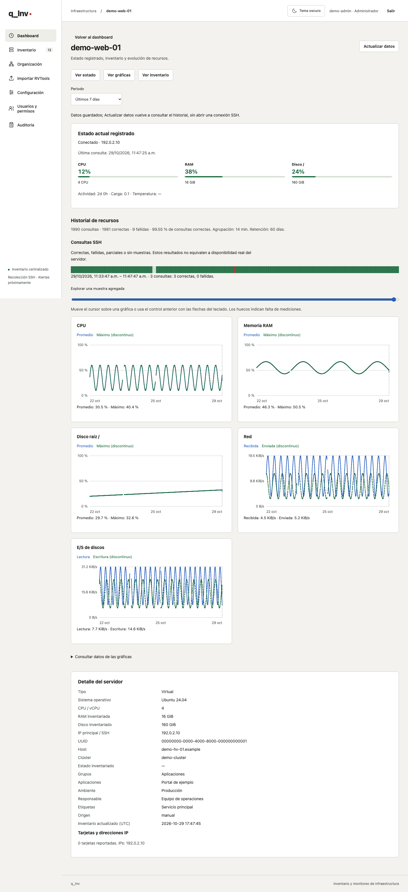
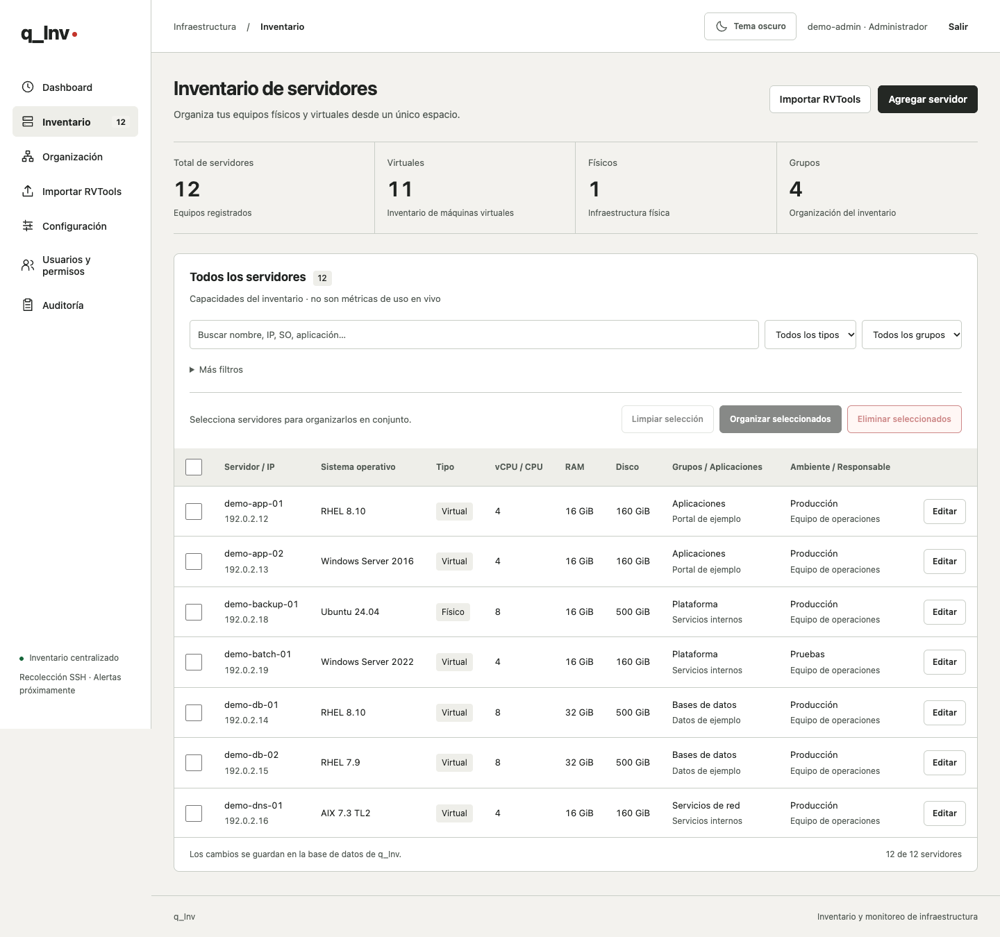
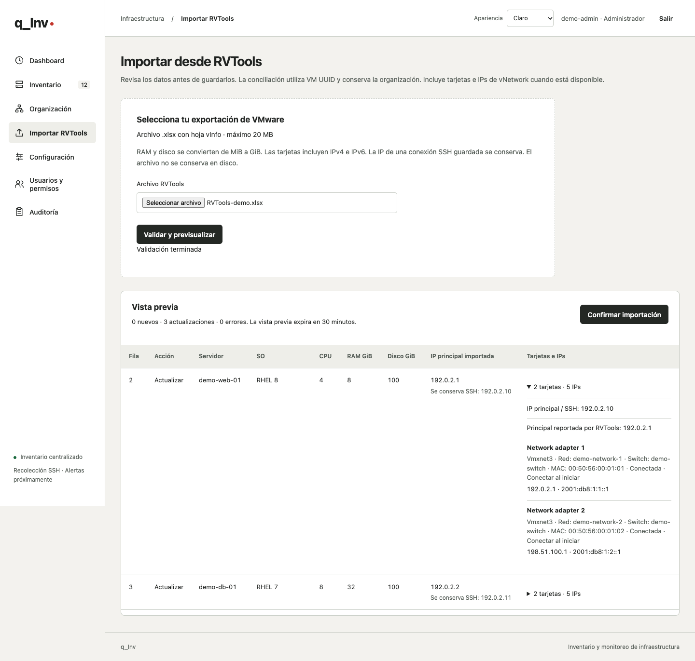
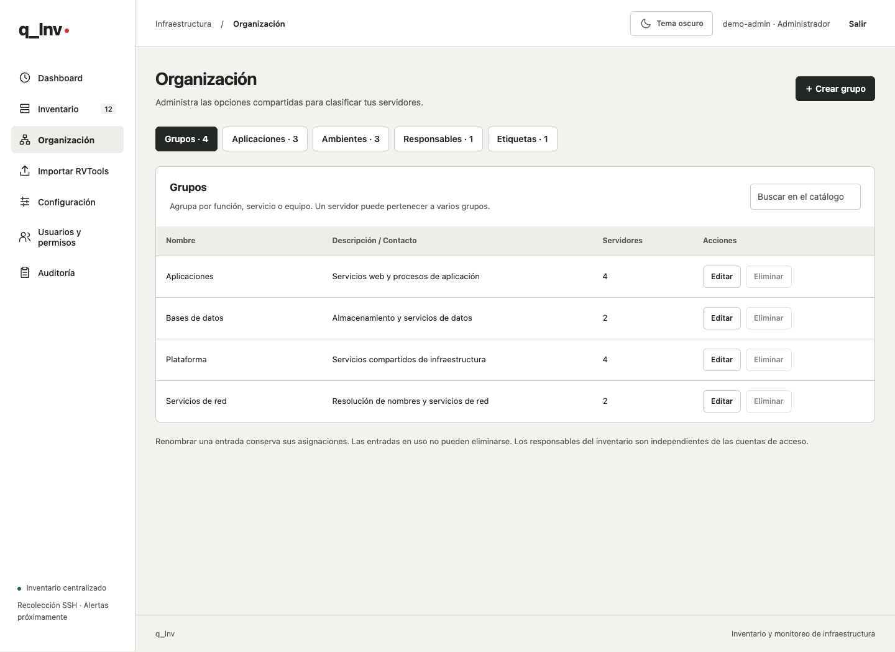
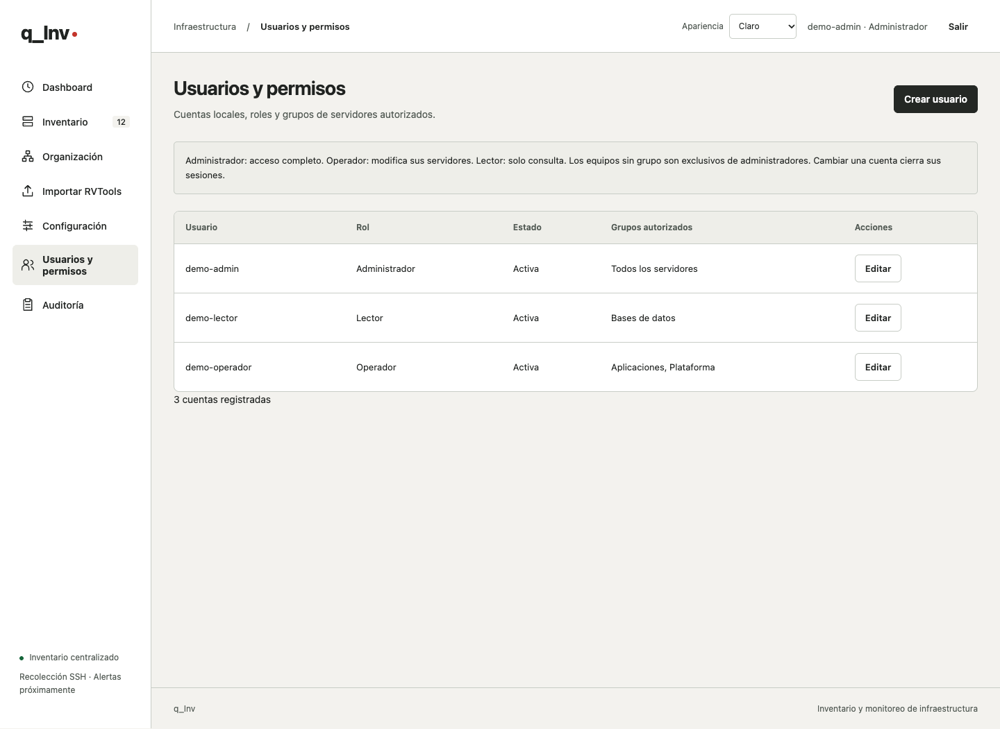
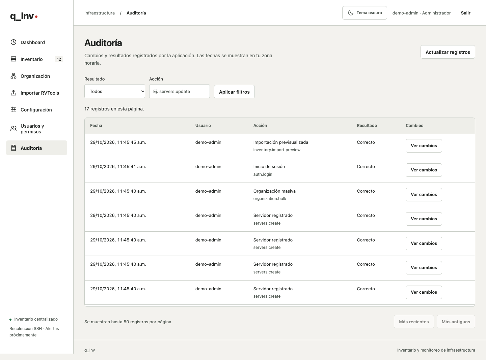
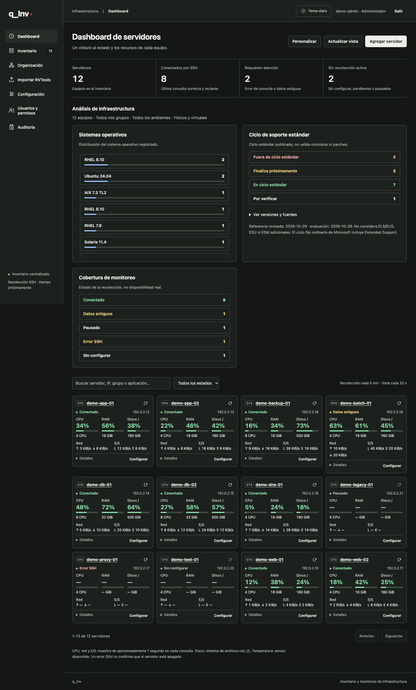

# q_Inv

**Inventario y monitoreo de servidores físicos y virtuales.**

q_Inv centraliza el inventario de infraestructura, organiza los equipos por servicio y aplicación, y permite consultar sus recursos desde una interfaz web. Combina importación de RVTools, registro manual, monitoreo SSH y control de acceso por grupos.

[](https://github.com/QRod/q_Inv/actions/workflows/tests.yml)

[Descargar](https://github.com/QRod/q_Inv/releases/latest) · [Instalación](docs/INSTALACION.md) · [Guía de uso](docs/GUIA-DE-USO.md) · [Cambios](CHANGELOG.md) · [Licencia MIT](LICENSE)



*Todas las capturas utilizan una instancia temporal con datos ficticios. Los nombres, direcciones IP, cuentas y métricas son ejemplos; no representan infraestructura real.*

## Funcionalidades

- **Inventario centralizado.** Registro y edición de servidores físicos y virtuales, con IP, sistema operativo, UUID, CPU, RAM, disco, host y clúster.
- **Importación RVTools.** Inventario desde `vInfo` y tarjetas desde `vNetwork`, con varias IPs IPv4/IPv6, validación, vista previa y conciliación por UUID sin duplicados.
- **Organización flexible.** Varios grupos y aplicaciones por servidor, ambiente, responsable principal y etiquetas; búsqueda, filtros y clasificación masiva.
- **Widgets personalizables.** Sistemas operativos y ciclo de soporte estándar, cobertura de monitoreo, presión de recursos, capacidad por aplicación y calidad del inventario; filtros, orden y umbrales guardados por cuenta.
- **Dashboard y gráficas.** Tarjetas compactas de recursos; al pulsar el nombre se abre una ficha con estado, inventario e historial interactivo de CPU, RAM, disco, red y E/S.
- **Monitoreo SSH.** Descubrimiento de inventario y recolección periódica Linux, con credenciales cifradas, comprobación de huella y retención configurable.
- **Usuarios y permisos.** Cuentas locales con roles Administrador, Operador y Lector, y visibilidad por grupos de servidores.
- **Auditoría.** Consulta de acciones, resultados y cambios anteriores/posteriores, sin incluir contraseñas.
- **Operación administrada.** Consulta manual de actualizaciones, comandos de respaldo y actualización, instalación Linux con systemd y HTTPS.
- **Interfaz adaptable.** Botón de tema claro/oscuro, navegación por teclado y vistas adaptadas a dispositivos móviles. La apariencia inicial sigue el sistema hasta elegir un tema.

## Pantallas

### Personalización y análisis

Selecciona los widgets y su orden, filtra por grupo o ambiente y ajusta el horizonte de soporte y los umbrales de recursos. Cada cuenta conserva su propia vista. Los recuentos abren el inventario de los equipos correspondientes.

<details>
<summary><strong>Ver opciones de personalización</strong></summary>



</details>

### Ficha e historial

Pulsar el nombre de una tarjeta abre el estado registrado, los datos del servidor y sus gráficas. Explora periodos y valores con el cursor o el teclado.

<details>
<summary><strong>Ver ficha y gráficas históricas</strong></summary>



</details>

### Inventario

Consulta capacidades y clasificaciones, expande tarjetas e IPs, busca por IP secundaria o MAC y realiza operaciones sobre la selección.



<details>
<summary><strong>Importación RVTools y organización</strong></summary>

La importación presenta los registros nuevos y las actualizaciones antes de confirmar. La conciliación conserva la clasificación existente.



Los catálogos comparten grupos, aplicaciones, ambientes, responsables y etiquetas entre servidores. Renombrar una entrada conserva sus asignaciones.



</details>

<details>
<summary><strong>Usuarios, permisos y auditoría</strong></summary>

Asigna roles y grupos a cada cuenta. Los operadores modifican equipos de sus grupos; los lectores solo consultan. Los servidores sin grupo son exclusivos de administradores.



Revisa acciones y resultados con filtros y detalles de los cambios registrados.



</details>

<details>
<summary><strong>Tema oscuro</strong></summary>

Un botón con icono de sol o luna alterna entre claro y oscuro. Antes de elegir, la apariencia sigue la configuración del sistema.



</details>

## Instalación rápida

Requiere una VM o servidor Linux con **systemd**, acceso administrativo y **Python 3.11 o posterior** disponible en los repositorios de la distribución.

Descarga y revisa el instalador de la versión estable; sustituye `SERVIDOR` por la IP o el nombre del servidor:

```sh
curl -fsSL https://raw.githubusercontent.com/QRod/q_Inv/v0.8.0/install.sh -o q-inv-install.sh
less q-inv-install.sh
sudo bash q-inv-install.sh --version v0.8.0 --address SERVIDOR --https-port 8443
```

Crea la primera cuenta administradora:

```sh
sudo q-inv-admin --create-user admin
```

Accede a `https://SERVIDOR:8443`. La opción HTTPS local requiere confiar en la CA generada por la instalación. También se admite certificado público con dominio o un proxy inverso existente.

El instalador verifica el SHA-256 de la entrega, crea un servicio sin privilegios y separa código, datos y configuración. Consulta la [guía de instalación](docs/INSTALACION.md) para las familias Linux, HTTPS, migración y recuperación.

## Compatibilidad y alcance

| Área | Alcance actual |
|---|---|
| Instalación | Linux con systemd y Python 3.11+. Rutas para familias Debian/Ubuntu, Fedora/RHEL, openSUSE y Arch. |
| Inventario | Alta manual de servidores físicos y virtuales; importación de `vInfo` y redes de `vNetwork` de RVTools. |
| Monitoreo periódico | Linux mediante SSH con algoritmos modernos. Intervalo inicial de 5 minutos y retención de 60 días, configurables. |
| Otros sistemas | Consultas de descubrimiento para AIX y SunOS pendientes de validación por plataforma; Windows admite inventario manual/importado, sin recolector específico. |
| Identidad | Usuarios locales. Active Directory no está integrado. |
| Actualizaciones | Consulta de publicaciones estables y guía de comandos; instalación ejecutada por el administrador del sistema. |

Las capacidades de inventario se distinguen del consumo medido. El disco del dashboard corresponde al sistema de archivos raíz `/`; un error SSH no demuestra que el servidor esté apagado. La compatibilidad de sistemas antiguos debe verificarse por versión; no se habilitan algoritmos SHA-1. Las alertas y las proyecciones de capacidad no están integradas. El ciclo de soporte es una referencia de planificación basada en la versión registrada y en fuentes del fabricante; no certifica contratos ni parches.

## Documentación

- [Widgets y soporte](docs/WIDGETS.md): personalización, indicadores, catálogo de fabricantes y límites de interpretación.
- [Ficha e historial](docs/HISTORIAL.md): gráficas, rangos, exploración y resultados de consultas SSH.
- [Guía de uso](docs/GUIA-DE-USO.md): dashboard, inventario, clasificación, RVTools y conexión SSH.
- [Instalación](docs/INSTALACION.md): requisitos, distribuciones, HTTPS y despliegue.
- [Acceso y operación](docs/ACCESO-Y-OPERACION.md): permisos, auditoría, respaldo, restauración y actualizaciones.
- [Desarrollo](docs/DESARROLLO.md): ejecución desde código, pruebas y empaquetado.
- [Historial de cambios](CHANGELOG.md) y [publicaciones](https://github.com/QRod/q_Inv/releases).

## Licencia

q_Inv se distribuye bajo la [licencia MIT](LICENSE). Las dependencias conservan sus licencias correspondientes.
